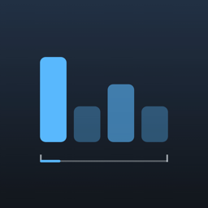
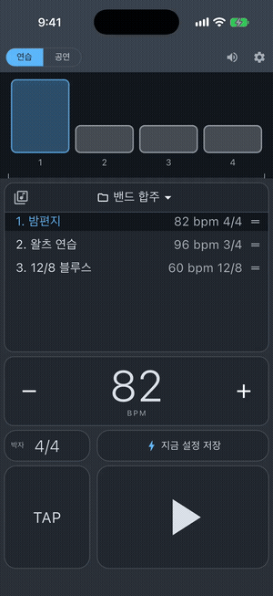
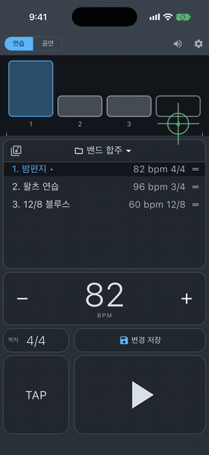
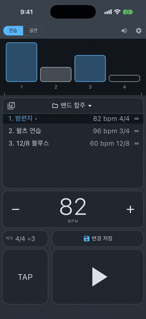
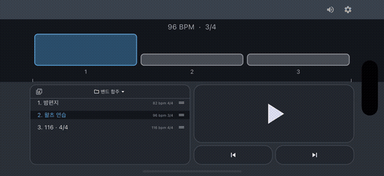

<p align="center">
  
</p>

<h1 align="center">똑딱 · DDokTTak</h1>

<p align="center">
  보면대 위에 올려 두고 쓰는, 박이 정확한 개인용 메트로놈
</p>

<p align="center">
  
  
  
  
  
</p>

---

폰을 보면대에 올려 두고 연습할 때 쓰려고 만든 **개인용 메트로놈 앱**입니다.
Frozen Ape 의 메트로놈 앱 *Tempo* 를 오래 써 오면서 "이런 게 있었으면" 싶던 부분은 더하고, 쓰지 않던 기능은 덜어 내는 데서 출발했습니다.
기능 구성만 참고했고, 이름·아이콘·소리·화면 디자인은 따라 하지 않고 새로 만들었습니다.

## 한눈에 보기

| | |
|---|---|
| **정확한 박** | 오디오 엔진 시계에 미리 예약해서, 앱이 바빠도 박이 밀리지 않아요 · BPM 20~400 |
| **자유로운 박자** | 박 수 1~16 × 음표 단위 1~16, 박마다 4단계 세기, **박 나누기 1~4** (띡 똑 딱) |
| **소리 7종** | 우드블록 · 전자 클릭 · 비프 · 기계식 틱 · 클라베스 · 카우벨 · 디지털 (모두 직접 합성) |
| **연습과 공연** | 세로는 연습·공연, 가로로 돌리면 공연 화면 · 공연 화면은 재생 전후 버튼 위치가 같아요 |
| **곡 관리** | 곡 보관함 → 폴더(연주목록)에 담기 · 저장 버튼 하나 · 폴더 순서 바꾸기 |
| **주고받기** | 폴더를 **파일(AirDrop·메시지)** 이나 **QR** 로 보내고 받기 (똑딱이 있는 iPhone 끼리) |
| **보이는 박** | 박 칸, 화면 깜빡임, 왕복하는 박 진행 막대가 소리와 같은 순간에 · **블루투스 이어폰도 자동으로 맞춤** + 보정 막대 |
| **스킨 5종** | 블루 나이트 · 선셋 · 라벤더 · 모노 · 라이트 (글자 대비 4.5 이상) |
| **화면 꺼져도** | 화면 잠금 · 무음 스위치에도 계속 재생 · **유튜브·음악 앱 소리와 함께** · 재생 중엔 자동 잠금 안 됨 · **이어폰을 뽑으면 멈춤** |

## 🎬 미리 보기

<table>
  <tr>
    <td align="center" width="25%"></td>
    <td align="center" width="25%"></td>
    <td align="center" width="25%"></td>
    <td align="center" width="25%"></td>
  </tr>
  <tr>
    <td valign="top"><b>① 소리에 맞춘 박 표시</b><br>▶ 를 누르면 박 칸이 소리와 같은 순간에 빛나요. 화면 깜빡임과 아래 박 진행 막대도 박에 맞춰 움직여요.</td>
    <td valign="top"><b>② 박 세기 · 박 나누기</b><br>박 칸을 누를 때마다 강세 → 약한 강세 → 보통 → 무음. 박자 휠에서 박 나누기 3을 고르면 "띡 똑 딱".</td>
    <td valign="top"><b>③ BPM 조절</b><br>큰 숫자를 좌우로 밀거나, − / + 를 꾹 누르면 점점 빠르게 바뀌어요. TAP 을 두드려 맞출 수도 있어요.</td>
    <td valign="top"><b>④ 저장 버튼 하나 · 연주목록</b><br>고친 곡은 [새 곡으로 / 덮어쓰기] 중에 골라 저장. 곡을 누르면 바로 바뀌고, 왼쪽으로 밀면 폴더에서 빠져요.</td>
  </tr>
</table>

<p align="center">
  
</p>
<p align="center">
  <b>⑤ 가로 = 공연 화면 · 스킨</b><br>
  폰을 가로로 돌리면 공연 화면. 큰 재생 버튼과 ⏮ ⏭ 로 연주목록을 넘기고, 스킨 5종으로 색을 바꿔요.
</p>

<sub>※ 시뮬레이터에서 자동으로 찍은 영상이라 소리는 없고, 흰 동그라미는 누른 위치 표시예요 (실제 앱에는 나오지 않아요). 5초에 맞추려고 조금 빠르게 재생했어요.</sub>

## 목차
- [미리 보기](#-미리-보기) · [이런 걸 고민했습니다](#이런-걸-고민했습니다)
- [어떻게 만들었나](#어떻게-만들었나)
- [구조](#구조) · [실행](#실행) · [버전](#버전) · [다음에 할 것](#다음에-할-것)
- [후원하기](#-후원하기) · [만든 사람과 라이선스](#만든-사람과-라이선스)

---

## 이런 걸 고민했습니다

### 1. 어디서 돌아가게 할까 — 웹앱, Swift, Flutter
처음엔 설치가 자유로운 **웹앱(PWA)** 이 끌렸습니다. 하지만 조사해 보니 iPhone 에서는 **화면이 잠기거나 다른 앱으로 넘어가면 소리가 멈춥니다.**
폰을 내려 두고 소리만 들으며 연습하다가 가끔 눈으로 박을 따라가는 사용 방식에는 맞지 않았습니다.

iPhone 만 쓴다면 Swift 가 가장 정확하지만, 나중에 다른 기기도 쓰고 싶어서 **Flutter** 로 정했습니다.
스토어에 올리지 않고 무료 Apple ID 로 내 폰에 직접 설치해 씁니다 (7일마다 다시 설치).

### 2. 박자가 정말 정확해야 한다
메트로놈은 박이 1ms 만 흔들려도 티가 납니다. 앱의 타이머(Dart Timer)로 소리를 내면 앱이 잠깐만 바빠져도 박이 밀립니다.
그래서 **오디오 엔진의 시계에 0.25초 앞의 박을 미리 예약**해 두는 방식(lookahead)을 택했습니다. 앱이 버벅여도 소리는 예약된 순간에 정확히 납니다.

본 구현 전에 Mac 에서 **실험용 앱(스파이크)** 을 따로 만들어 검증했고, 그 과정에서 문서에는 없는 함정을 찾았습니다.
- 동시에 예약할 수 있는 소리가 기본 16개라, 넘치면 **오래된 예약이 에러 없이 사라짐** → 한도를 128로 올림
- 예약이 하나도 없으면 0.5초 뒤 **엔진 시계가 멈춤** → 재생 중에는 들리지 않는 예약을 하나 걸어 두어 시계를 계속 돌림
- BPM 을 바꿀 때 "지금 + 20ms 이후" 박만 취소해야 이미 울리기 시작한 소리가 끊기지 않음

### 3. 화면이 소리와 맞아야 한다
박 칸이 빛나는 순간, 화면 깜빡임, 박 진행 막대가 **소리가 실제로 나는 순간**에 맞도록 엔진 시계와 화면 시계를 계속 맞춥니다.
블루투스 이어폰은 원래 0.15~0.3초 늦게 들립니다. 박 간격은 정확해도 화면이 앞서 보여서, **iOS 가 알려 주는 출력 지연만큼 화면을 자동으로 늦춥니다** (앱을 켤 때, 이어폰을 바꿀 때, ▶ 를 누를 때 다시 읽음).
기기마다 조금씩 다를 수 있어 ⚙ 에 **화면 타이밍 보정** 막대(±250ms)도 두었습니다.

### 4. 화면 잠금, 무음 스위치
iPhone 에서 화면을 끄면 클릭이 멈추는 문제가 있었습니다. 원인은 소리 엔진이 iOS **오디오 세션 종류**를 정하지 않아 기본값(잠금·무음 시 멈춤)이 쓰였기 때문입니다.
세션을 **재생(Playback)** 으로 직접 정해, 화면을 꺼도·무음 스위치를 켜도·음악 앱과 함께 써도 소리가 납니다. 전화가 오면 깔끔하게 멈춥니다.

그런데 써 보니 두 가지가 남아 있었습니다. **▶ 를 눌러도 첫 박이 살짝 늦고**, **똑딱을 켜면 배경에서 듣던 유튜브가 꺼졌어요.**
"유선 이어폰인데도 늦다", "다른 앱은 괜찮다", "유튜브가 꺼진다"는 세 가지 관찰을 합쳐 보니 뿌리가 하나였습니다.
소리 엔진을 **먼저** 켜고 세션 설정을 **나중에** 바꾸는 순서였던 거예요. 엔진이 iOS 기본 설정(다른 소리 끄기)으로 시작해 유튜브를 끄고,
뒤늦게 설정을 바꿀 때 iOS 가 소리 장치를 끊었다 다시 연결하면서, 바로 울리도록 켜 둔 장치가 꺼진 채 남았습니다.
**설정을 먼저, 엔진을 나중에** 켜는 순서로 바꾸자 유튜브와 함께 들리고 ▶ 도 바로 울립니다. 이어폰을 꽂고 빼거나 전화가 끝난 뒤에도 장치를 다시 켜 둡니다.
**이어폰을 뽑으면 바로 멈춥니다.** 지하철이나 조용한 곳에서 갑자기 스피커로 딸깍거리지 않도록요.

### 5. 소리는 파일 대신 직접 만들기
다른 앱의 소리를 가져오지 않기 위해, 그리고 용량을 늘리지 않기 위해 **모든 클릭을 앱 안에서 합성**합니다.
가장 많이 쓰이는 소리를 조사해 우드블록(기본)·전자 클릭·비프·기계식 틱·클라베스·카우벨을 넣었고, 짧고 선명한 **디지털** 클릭을 더했습니다 (7종).
첫 박은 같은 소리를 조금 높고 크게 내서 구분합니다.
클릭 소리는 찌그러지지 않는 한도(최대 0.98) 안에서 몸통을 살짝 두껍게 해 **들리는 크기를 약 2dB 키웠고**, 그보다 작게는 🔊 볼륨으로 조절합니다.

### 6. 박자와 세기
- 박자는 2/4, 3/4 같은 고정 목록 대신 **박 수 1~16, 음표 단위 1~16** 을 휠로 자유롭게 고릅니다.
- 박마다 **4단계 세기**(강세 / 약한 강세 / 보통 / 무음)를 칸을 눌러 바꿉니다. 3단계로는 6/8 의 "1박 강하게, 4박 조금 강하게" 를 만들 수 없어서 4단계로 정했습니다.
- 강세가 얼마나 크게 들릴지는 설정의 **강세 세기** 하나로 조절합니다.
- BPM 은 20~400. 숫자를 **좌우로 밀거나**, −/+ 를 **꾹 누르면** 점점 빠르게 바뀝니다. 짧게 누르기와 꾹 누르기가 겹치지 않도록 "닿는 순간 1, 0.4초 넘게 누르면 반복" 하나로 처리했습니다.

### 7. 곡 저장 — 단순하게
"쇼핑하듯 담기" 를 떠올려 **곡 보관함 → 담기 → 폴더(연주목록)** 구조로 만들었습니다. 같은 곡을 여러 폴더에 담을 수 있습니다.
저장 방식은 여러 번 바뀌었습니다.
- 자동 저장 + 되돌리기 → 연습하다 바꾼 템포까지 저장되는 문제
- 업데이트 / 새로 저장 / 간편 저장 / + 버튼 → 기능은 맞지만 "뭐가 다르지?" 가 생김
- 최종: **저장 버튼 하나.** 그냥 누르면 "120 · 4/4" 처럼 바로 저장되고, 불러온 곡을 고친 상태면 [덮어쓰기 / 새 곡으로] 를 묻습니다.

되돌리기 기능은 복잡해서 넣지 않았고, 되돌릴 수 없는 **보관함 삭제에만 확인 창**을 둡니다.

**주고받기**는 서버 없이 만들었습니다. 연주목록 머리의 보내기 버튼으로 지금 폴더를
- **파일**(`.ddokttak`)로 AirDrop·메시지·파일 앱에 보내거나,
- **QR** 로 보여 주면 상대가 iPhone 카메라로 찍어 바로 받습니다 (내용이 QR 안에 들어 있어 인터넷이 필요 없어요).

받는 쪽은 "곡 N개를 받을까요?" 를 확인한 뒤 **새 폴더 "받음 · 폴더 이름"** 에 담깁니다. 지금 있는 곡은 바뀌지 않고, 이름과 설정이 같은 곡은 새로 만들지 않습니다.
남이 보낸 내용이라 곡 수·이름 길이·크기를 제한하고, 형식이 틀리면 받지 않습니다. 곡 이름과 설정만 들어가고 개인정보는 없습니다.
지금은 **똑딱이 깔린 iPhone 끼리만** 됩니다 (Android 버전이 생기면 같은 형식으로 이어집니다).

### 8. 연습과 공연
- **세로 = 연습/수정, 가로 = 공연.** 폰을 가로로 돌리면 공연 화면이 되고, 세로로 돌리면 원래 모드로 돌아옵니다.
  좁은 장소처럼 세로만 쓸 수 있을 때를 위해 세로 공연 화면도 있습니다.
- 연습 중 ▶ 를 누르면 화면이 바뀌는 "재생 집중 화면"도 만들어 봤지만, 써 보니 연습 중에도 BPM·박자를 바로 고치는 일이 많아 원래 화면을 그대로 두기로 했습니다.
- 공연 화면은 무대에서 헷갈리지 않도록 **재생 전후 버튼 위치가 같습니다** (▶ 가 ■ 로만 바뀜).

### 9. 보기 좋고 읽기 좋게
- Tempo 처럼 어두운 바탕에 강조색 하나. 처음 연두색이던 강조색과 상단 줄은 "너무 따라 한 느낌" 이라 파란 계열로 바꾸고 줄은 뺐습니다.
- 화면을 구역으로 나눠 이름을 붙이고(상단바, 박 표시창, 연주목록, BPM 조절판 …) 그 이름으로 고칠 곳을 이야기했습니다.
- 숫자와 박 칸이 정말 가운데인지 **테스트로 재서** 확인합니다.
- **스킨 5종**(블루 나이트, 선셋, 라벤더, 모노, 라이트). 모든 스킨에서 글자와 바탕의 대비가 **4.5 이상**(WCAG)이 되도록 계산해 맞추고, 테스트가 이를 검사합니다.
- 화면은 폰 크기에 맞춰 끝까지 채우되, 버튼은 다이내믹 아일랜드·홈 막대에 가리지 않게 안전 영역 안에 둡니다.
- 시스템 글자 크기는 1.3배까지만 따라가 화면이 깨지지 않게 했습니다.

---

## 어떻게 만들었나

AI 코딩 도구 **Claude Code** 와 대화하며 만들었습니다. 저는 무엇을 원하는지와 매번의 결정을 맡고, 조사·설계·구현·검증은 역할을 나눈 AI 팀원들과 함께 했습니다.

| 단계 | 한 일 |
|---|---|
| 조사 | Tempo 기능, Flutter 정밀 오디오, iOS 웹앱 제약, 많이 쓰이는 클릭 소리 (`docs/research/`) |
| 설계 | 박자 스케줄러와 앱 구조 설계 (`docs/research/04-architecture-design.md`) |
| 검증 | Mac 실험 앱으로 예약 재생·취소·시계 동작 측정 (`spikes/audio_spike/logs`) |
| 목업 | Mac 에 iPhone 크기 창을 띄워 화면을 보며 하나씩 고침 |
| 실기기 | iPhone 에 설치해 화면 잠금·무음 스위치·블루투스를 직접 확인 |

진행 방식으로 지킨 것들
- 큰 변경은 **먼저 글로 확인하고, 수락하면 만든다.**
- 고칠 때마다 **자동 테스트**를 같이 넣는다 (현재 375개).
- 단계마다 멈추고, 결정과 진행 상황은 `CLAUDE.md` 에 남긴다.

---

## 구조

```
lib/
  domain/       박자표, 박 세기, 설정, 곡, 폴더 (순수 Dart)
  timeline/     박 시각 계산 (SchedulerCore, 누적 오차 없는 tick 계산)
  audio/        클릭 합성, WAV 변환, flutter_soloud 엔진, 오디오 세션
  transport/    엔진에 박을 예약하고 화면 표시를 소리에 맞춤
  persistence/  SQLite 저장 (곡, 폴더, 폴더-곡 순서, 앱 상태)
  share/        주고받기 곡 묶음 (파일·QR 링크 형식과 검사)
  platform/     iOS 와 주고받는 통로 (출력 지연, 파일·링크로 열기)
  state/        화면 컨트롤러
  ui/           화면과 위젯 (박 칸, 연주목록, BPM 제스처, 박자 휠 …)
test/           단위·화면·저장 테스트
tool/           클릭 소리 WAV 뽑기, 앱 아이콘 시안 그리기
docs/research/  조사와 설계 문서
spikes/         오디오 검증용 실험 앱
```

주요 패키지: `flutter_soloud`(예약 재생), `audio_session`(iOS 세션), `sqflite`(저장), `share_plus`(보내기), `qr_flutter`(QR)

## 실행

```bash
flutter pub get
flutter test                          # 테스트
flutter build macos --debug           # Mac 에서 화면 보기
flutter build ios --release           # iPhone 용 빌드
xcrun devicectl device install app --device <UDID> build/ios/iphoneos/Runner.app
```

- 클릭 소리 들어 보기: `dart run tool/render_clicks.dart` → `build/clicks/*.wav`
- 앱 아이콘 시안 다시 그리기: `flutter test tool/icon_drafts_test.dart` → `build/icons/`

## 버전

| 버전 | 내용 |
|---|---|
| **1.0.0** | 정확한 박자 엔진, 박자·세기, 소리 7종, 연습/공연, 곡 보관함·폴더, 스킨 5종, 화면 꺼짐 재생, 앱 아이콘 |
| **1.0.2** | 주고받기(파일·QR, iPhone 끼리), 블루투스 화면 자동 맞춤 + 보정 막대, 이어폰 뽑으면 멈추기, 폴더 순서 바꾸기 |
| **1.0.1** | 저장 버튼 하나, 처음 사용 안내, 기본 곡(60·120), 가로 = 공연, 재생 시작 지연 줄이기(소리 설정 순서), 유튜브·음악 앱과 함께 재생, 클릭 소리 크게(+2dB), 박 나누기(1~4), 재생 중 화면 꺼짐 막기 |

## 다음에 할 것
1. iPad 버전 (넓은 화면 2단 배치)
2. Android (화면 꺼짐 재생용 포그라운드 서비스)
3. 정식 출시 준비 (유료화, 스토어 자료, 접근성)

---

## ☕ 후원하기

똑딱은 보면대 위에서 직접 쓰려고 만든 메트로놈입니다.
연습실과 합주에서 같은 고민을 하는 분들과 나누고 싶어 무료로 공개했어요.

**후원하지 않아도 모든 기능을 그대로 쓸 수 있습니다.**
연습에 도움이 되셨다면 커피 한 잔으로 응원해 주세요.
후원금은 Apple 개발자 등록비(iPhone 에 정식으로 배포하기 위한 비용)와 새 기능 개발에 쓰입니다.

- 💖 GitHub Sponsors: https://github.com/sponsors/min-d-h
- 💬 버그 제보·기능 제안: [Issues](https://github.com/min-d-h/ddokttak/issues)

| 후원 | 금액 | 고마움의 표시 |
|---|---|---|
| ☕ 커피 한 잔 응원 | 월 $2 | 고마운 분들 명단에 이름 (익명 가능) |
| 🎵 합주 멤버 | 월 $5 | 명단 + **다음 기능 투표권** + **원하는 기능 우선순위 요청** (먼저 듣고 검토해요, 모든 요청을 약속하지는 못해요) |
| 🎼 한 번의 응원 | 1회 $10 이상 (원하는 금액 가능) | 명단에 이름 |

### 고마운 분들
후원해 주신 분들의 이름을 여기에 남깁니다. (원하지 않으시면 익명으로 올려요)

---

## 만든 사람과 라이선스

**donghyeon Min** · [@min-d-h](https://github.com/min-d-h)

직접 쓰려고 만들었고, 같은 고민을 하는 연주자들과 나누고 싶어 공개했습니다.

- 라이선스: **GPL-3.0** ([LICENSE](LICENSE))
  누구나 보고, 쓰고, 고칠 수 있습니다. 고친 앱을 배포할 때는 그 코드도 같은 라이선스로 공개해야 합니다.
- 이름 "똑딱", 앱 아이콘, 화면 디자인은 만든 사람의 것입니다. 이 코드로 다른 앱을 배포할 때는 다른 이름과 아이콘을 써 주세요.
- 버그 제보와 기능 제안은 Issues 로 받습니다. 코드 기여(Pull Request)를 보내 주시면, 그 기여를 이 프로젝트의 향후 버전(유료 정식판 포함)에 다른 라이선스로도 쓸 수 있도록 동의해 주신 것으로 봅니다.

Copyright © 2026 donghyeon Min

---

*Tempo 는 Frozen Ape 의 앱이며, 이 프로젝트와 관련이 없습니다.*
